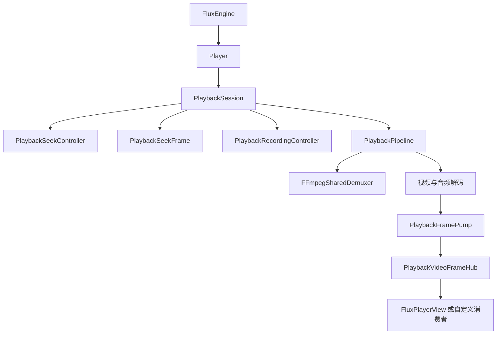

# 当前架构

公开创建入口为 `FluxEngine.CreatePlayer`。业务控制走 `Player`，原生线程、设备及会话为内部实现。
最新修改状态见 [项目状态](current-state.md)，本页描述源码设计，不表示运行验证已经通过。

## 生命周期

每代管线只运行一次，独占解复用器、解码器、设备、取消信号和输入帧队列。
打开、重播、Seek 重建和网络恢复共用管线创建与退役流程。
停止先取消请求并等待线程退出，再释放原生对象；引擎关闭等待播放器释放。
改变管线的操作共用会话异步锁，旧管线通知不会修改新管线状态。

## Seek 与画面

权限独立于输出时序选项，核心会话和解复用入口均进行检查。
请求只保留一组最新待执行目标，执行中的目标不被排队请求覆盖。
正常定位由现有解复用器执行，失败或 EOF 后才重建，不再改写压缩包队列进行定位。

数据包标记原生读取代次，解码器据此丢弃旧包并保留新位置首包。
VideoFrameEpoch 在跳转开始或管线退役时失效，帧泵、公开读取和显示前都会检查。
PlaybackSeekFrame 只接收本次代次的首帧，使用任务通知而非轮询诊断字段。
目标首帧直接用于预览，再恢复常规音视频调度。

## 输出与录制

VideoFrame.Retain 保留帧租约，消费方负责释放。异步显示前可再次检查 IsCurrent。
TimelineId 关联核心回调和显示提交；显示提交不等于物理屏幕扫描时刻。
Windows 显示实现包含 CPU 位图与 D3D11 共享纹理路径，其它平台需分别确认。
录制复用压缩包，控制器跨管线保管录制意图；不负责修复上游码流损坏。

## 日志与依赖

Logging 目录提供 FluxMediaLog 静态入口及内部输出端。
FFmpegLibraries 从绑定常量生成平台库名，并检查完整目录及实际 ABI。
任意主版本支持尚未实现，直接原生结构布局仍是限制，见 [部署说明](ffmpeg-deployment.md)。
Shared 中的 IsExternalInit 是 netstandard2.1 的 record/init 编译标记，不是业务兼容层。
