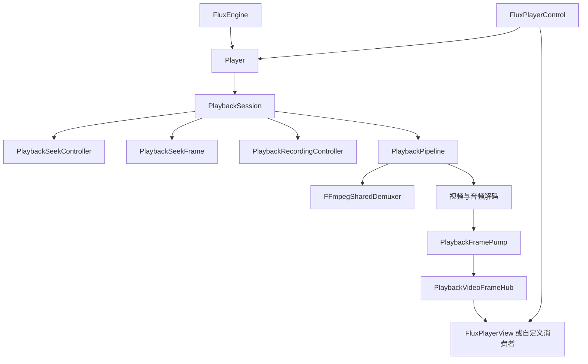

# 当前架构

公开创建入口为 `FluxEngine.CreatePlayer`。业务控制走 `Player`，原生线程、设备及会话为内部实现。

`FluxPlayerControl` 组合显示层、基础命令和使用方提供的控制栏模板。它只借用外部 Player，
显隐、输入和错误提示留在 Avalonia 层，全屏由宿主响应请求。

## 源码职责目录

`FluxMedia.Playback` 根目录提供 `FluxEngine`、`Player` 和 `FFmpegLibraries` 公开入口。
内部实现按职责组织；目录与命名空间分别表达源码位置和类型身份。
独立类型以类型名分别存放；较大的私有辅助类型通过 `partial` 分文件，保留原有嵌套作用域。

| 目录 | 职责 |
| --- | --- |
| [Sessions](../src/FluxMedia.Playback/Internal/Sessions) | 会话生命周期、状态转换、控制协调和位置通知 |
| [Pipeline](../src/FluxMedia.Playback/Internal/Pipeline) | 一代播放管线的任务、资源与回调 |
| [Demuxing](../src/FluxMedia.Playback/Internal/Demuxing) | 打开参数、媒体信息、流描述与解复用 |
| [Packets](../src/FluxMedia.Playback/Internal/Packets) | 压缩包租约、队列与读取 |
| [Decoding](../src/FluxMedia.Playback/Internal/Decoding) | 音视频解码工作器及解码诊断 |
| [Timing](../src/FluxMedia.Playback/Internal/Timing) | 音视频同步、呈现节奏、音频时间线和倍速策略 |
| [Video](../src/FluxMedia.Playback/Internal/Video) | 视频帧池、帧泵和公开帧分发 |
| [Seeking](../src/FluxMedia.Playback/Internal/Seeking) | Seek 合并、重同步与本代首帧等待 |
| [Recording](../src/FluxMedia.Playback/Internal/Recording) | 录制控制与压缩包重封装 |
| [Audio](../src/FluxMedia.Playback/Internal/Audio) | 音频设备、变速滤镜和输出诊断 |
| [FFmpeg/Native](../src/FluxMedia.Playback/Internal/FFmpeg/Native) | 原生库加载、初始化与 FFmpeg 错误转换 |
| [Hardware](../src/FluxMedia.Playback/Internal/Hardware) | 硬件视频上下文 |

配置、公开数据类型和日志分别位于 `Configuration`、`Models`、`Logging`。
Avalonia 显示位于独立的 `FluxMedia.Avalonia` 项目，自定义 UI 可直接使用核心帧输出。

媒体源规则集中在 `Demuxing/MediaSourcePolicy`：公开字符串入口调用地址解析，
会话在打开前统一校验媒体类型、协议、主机与文件存在性。
`PlaybackFFmpegOptions` 按协议生成参数，实际传入 FFmpeg 的参数集合同时用于诊断文本。
Seek 能力和倍速范围分别由 `PlaybackTimingPolicy`、`PlaybackRatePolicy` 维护。
基础时序由 `PlaybackTimingPolicy` 在流信息就绪后确定，保存在解复用器中，
再通过管线的工作上下文交给视频 Worker，避免读取和呈现各自判定媒体模式。

解码工作器通过 `PlaybackWorkerContext` 共享媒体信息及实时控制入口，
通过 `FFmpegPacketInput` 接收流参数、包读取器和代次；音视频专用回调分别组织。
这些依赖对象在每代管线启动时创建，资源仍由管线管理。
工作器直接持有依赖分组，实时读取播放控制；本次运行统计直接用于视频诊断上报，
音频设备的暂停和恢复由工作器内同一方法处理。

## 生命周期

每代管线只运行一次，独占解复用器、解码器、设备、取消信号和输入帧队列。
打开、重播、Seek 重建和网络恢复共用管线创建与退役流程。
停止先取消请求并等待线程退出，再释放原生对象；引擎关闭等待播放器释放。
改变管线的操作共用会话异步锁，旧管线通知不会修改新管线状态。
管线持续观察解复用、解码及帧泵任务，任一失败即取消其余任务。
正常结束时先排空解码数据，再完成帧泵，等待尾帧和尾音结束。
音视频工作器在清理后上报最终诊断，并保留本次运行的错误信息。
释放阶段逐项执行清理并汇总异常，单项失败不跳过其余资源。
退役返回清理结果，由命令层完成状态迁移后反馈异常，避免停留在过渡状态。

## Seek 与画面

权限独立于输出时序选项，核心会话和解复用入口均进行检查。
请求只保留一组最新待执行目标，执行中的目标不被排队请求覆盖。
正常定位由现有解复用器执行，失败或 EOF 后才重建，不再改写压缩包队列进行定位。

数据包标记原生读取代次，解码器据此丢弃旧包并保留新位置首包。
VideoFrameEpoch 在跳转开始或管线退役时失效，帧泵、公开读取和显示前都会检查。
PlaybackSeekFrame 只接收本次代次的首帧，使用任务通知而非轮询诊断字段。
目标首帧直接用于预览，再恢复常规音视频调度。
待处理 Seek 可通过 FFmpeg 中断回调结束读包等待；打开和原生定位阶段不启用该条件。
主动中断不计为网络超时，协议无法继续定位时沿用管线重建路径。
Seek 实际位置来自本代首个有效输出帧，原生定位完成只表示请求已执行。

## 输出与录制

VideoFrame.Retain 保留帧租约，消费方负责释放。异步显示前可再次检查 IsCurrent。
TimelineId 关联核心回调和显示提交；显示提交不等于物理屏幕扫描时刻。
Windows 显示实现包含 CPU 位图与 D3D11 共享纹理路径，其它平台需分别确认。
录制复用压缩包，控制器跨管线保管录制意图；不负责修复上游码流损坏。
停止录制通过异步等待完成排空、封装和释放，再解除录制器关联。
接受停止前允许取消，开始收尾后以最终封装结果为准。
录制分别判断封装、关闭和有效数据，文件信息查询不参与判定录制成败。

## 日志与依赖

Logging 目录提供 FluxMediaLog 静态入口及内部输出端。
FFmpegLibraries 从绑定常量生成平台库名，并检查完整目录及实际 ABI。
任意主版本支持尚未实现，直接原生结构布局仍是限制，见 [部署说明](ffmpeg-deployment.md)。
Shared 中的 IsExternalInit 是 netstandard2.1 的 record/init 编译标记，不是业务兼容层。
